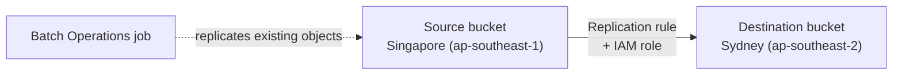

# Amazon S3 Cross-Region Replication (Singapore to Sydney)

A hands-on cloud project where I automatically copy objects from an S3 bucket in **Asia Pacific (Singapore)** to a bucket in **Asia Pacific (Sydney)** using **S3 Cross-Region Replication (CRR)**, set up with the AWS Console.

This is project 3 in my cloud and DevOps learning series.

## What I built

- A source bucket in Singapore (`ap-southeast-1`) and a destination bucket in Sydney (`ap-southeast-2`), both with versioning enabled
- A replication rule that applies to all objects in the source bucket
- An IAM role, created automatically, that lets S3 copy objects between the buckets
- A Batch Operations job that replicated the objects that already existed in the source bucket

## Architecture

## Steps

### 1. Create the source bucket (Singapore)
1. Open **S3** and click **Create bucket**
2. Bucket type: **General purpose**, namespace: **Global**
3. Bucket name: `s3-bucket-project-kavya-singapore`
4. Object Ownership: **ACLs enabled**, **Bucket owner preferred**
5. Block Public Access: uncheck "Block all public access" and tick the acknowledgement
6. Bucket Versioning: **Enable**
7. Click **Create bucket**

### 2. Create the destination bucket (Sydney)
1. Switch the region to **Asia Pacific (Sydney)**
2. Create a bucket named `s3-bucket-project-kavya-sydney` with the same settings as above
3. Make sure **Bucket Versioning is enabled**

### 3. Create the replication rule
1. Open the Singapore bucket, go to the **Management** tab
2. Under **Replication rules**, click **Create replication rule**
3. Rule name: `SingaporetoSydneyreplicationsetup`, Status: **Enabled**
4. Source: `s3-bucket-project-kavya-singapore` (ap-southeast-1), rule scope: **Apply to all objects in the bucket**
5. Destination: **Choose a bucket in this account**, browse and select `s3://s3-bucket-project-kavya-sydney` (ap-southeast-2)
6. IAM role: **Create new role**
7. Click **Save**

### 4. Replicate existing objects
1. When asked "Replicate existing objects?", choose **Yes, replicate existing objects**
2. Job run options: **Automatically run the job when it's ready**
3. Completion report destination: browse and select the Sydney bucket
4. Permissions: **Create new role**
5. Click **Save**

### 5. Verify
1. Open the Sydney bucket and check the **Objects** tab
2. The two files from Singapore (`index.html` and `error.html`) appear in Sydney, plus a folder with the Batch Operations completion report

### 6. Clean up
1. Delete all objects in both buckets
2. Delete both buckets, so there are no leftover resources or charges

## Results

**Batch Operations job: completed, 2 objects, 100% complete, 0 failed**

**Objects replicated into the Sydney bucket**

## Notes and what I learned

- **Versioning must be enabled** on both the source and destination buckets, or replication cannot be created.
- A replication rule normally copies only **new** objects. To copy objects that already exist, you run a **Batch Operations** job, which is what I did here.
- S3 uses an **IAM role** to copy objects on my behalf, so it needs permission in both buckets.
- Cross-region replication is useful for **disaster recovery**, lower latency for users in another region, and meeting data-residency rules.
- I kept the public-access settings from my earlier project. Replication itself doesn't need public access, so for real data I would keep **Block Public Access on**.
- I deleted all resources after testing.

## Next steps

- Try replication with a **bucket policy** instead of ACLs
- Compare **same-region replication** with cross-region replication
- Automate the setup with the AWS CLI or Terraform

## Tools

AWS Console, Amazon S3, IAM, S3 Batch Operations
